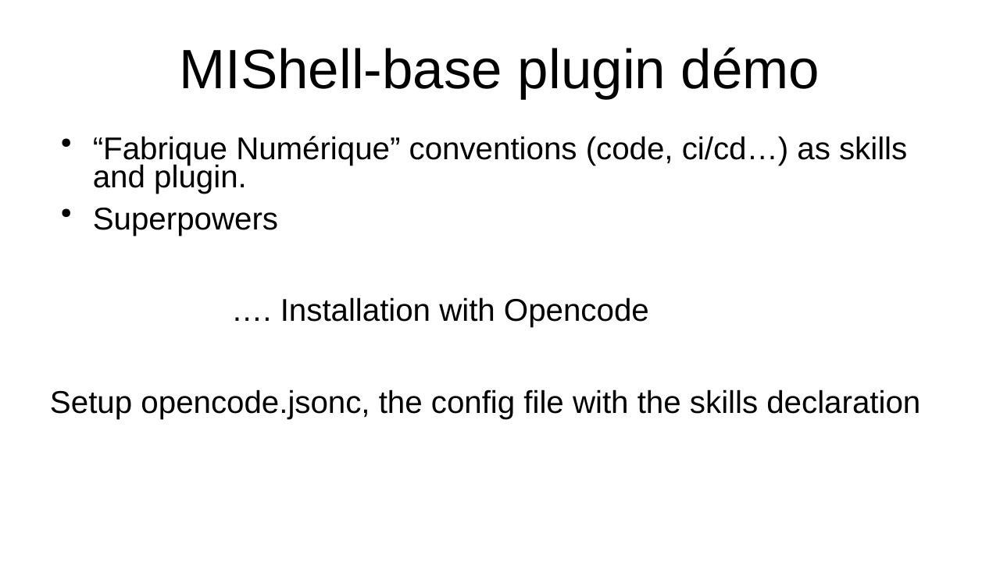
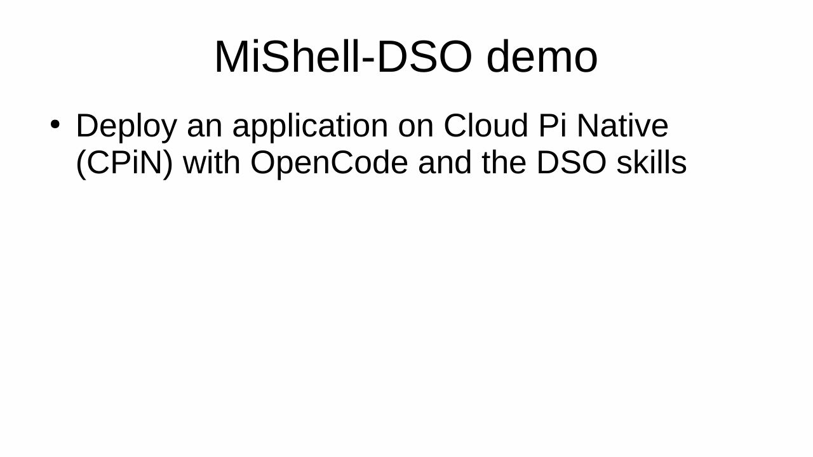

# mishell

Skill bundles from the IA-Generative team for coding agents, for both
[Claude Code](https://claude.com/claude-code) and [OpenCode](https://opencode.ai). This repository
contains **no skill**: it chooses which ones to install, each **pinned to a commit**, from the
repositories listed in [What is in each bundle](#what-is-in-each-bundle).

The repository is **public**: no GitHub login is required.

## Requirements

To install a bundle:

- [Claude Code](https://claude.com/claude-code) or [OpenCode](https://opencode.ai) ≥ 1.18 (tested
  with 1.18.35);
- `git`, and access to github.com.

To change a bundle ([CONTRIBUTING.md](CONTRIBUTING.md)):

- [`gh`](https://cli.github.com), logged in: issues and pull requests;
- Node.js, to run the tests (built-ins only, no `npm install`; tested with 24), and the CLI of
  each agent you check. A model per agent only for `MISHELL_LLM`
  ([docs/testing.md](docs/testing.md)).

## Install

Each step builds on the previous one. Open the one you need.

### 1. The essentials: working principles

Four short principles based on a post by Karpathy
([third-party repository](https://github.com/multica-ai/andrej-karpathy-skills), outside the bundles).

<details>
<summary>Commands</summary>

&nbsp;

```bash
# Claude Code
claude plugin marketplace add multica-ai/andrej-karpathy-skills
claude plugin install andrej-karpathy-skills@karpathy-skills --scope local
```

Optional: a complete development method (TDD, debugging, review). Take only one of the two, they
overlap: [`mattpocock/skills`](https://github.com/mattpocock/skills) (pick and choose) or
[`obra/superpowers`](https://github.com/obra/superpowers) (chained).

```bash
# Claude Code
claude plugin install mattpocock-skills@claude-plugins-official --scope local
# or
claude plugin install superpowers@claude-plugins-official --scope local
```

OpenCode commands, reviewed commits and licences: [docs/external-sources.md](docs/external-sources.md).

</details>

### 2. Starting a project: `mishell-base`

The Fabrique Numérique foundation: CI/CD, conventions, stack, REST API, deployment.



The app built in this demo: [IA-Generative/mishell-demo](https://github.com/IA-Generative/mishell-demo).

<details open>
<summary>Commands</summary>

&nbsp;

```bash
# Claude Code
claude plugin marketplace add IA-Generative/mishell
claude plugin install mishell-base@mishell --scope local
```

**OpenCode**: copy [opencode.jsonc](opencode.jsonc) into your `opencode.json`. `mishell-base` is
enabled there by default; details in [docs/installation.md](docs/installation.md#opencode).

`--scope local` means this project only, without changing any versioned file (default `user`: all
your sessions; `project`: shared with the team through git).

</details>

### 3. The project grows: `mishell-more`

Audits (pen-test, red-team, RAG), DAT security accreditation files, MirAI, DSO / Cloud Pi Native,
ANSSI guides, RGAA.



The app deployed in this demo: [IA-Generative/translate-rt](https://github.com/IA-Generative/translate-rt).

The steps follow the [DSO runbook for deploying on Cloud Pi Native](https://github.com/dnum-mi/starter-kit-opencode/blob/main/docs/runbook-deploiement-cpin.md) (in French).

<details>
<summary>Commands</summary>

&nbsp;

```bash
# Claude Code
claude plugin install mishell-more@mishell --scope local
```

```json
// OpenCode: opencode.json (audit, DAT, MirAI; DSO, ANSSI, RGAA: see docs/installation.md)
// <sha>: the mishell-agent-skills commit in .claude-plugin/marketplace.json
{ "plugin": [["agent-skills@git+https://github.com/IA-Generative/agent-skills.git#<sha>",
              { "groups": ["audit", "dat", "mirai"] }]] }
```

Only one family, for example the DSO skills: [pick and choose](docs/installation.md#pick-and-choose).

</details>

## What is in each bundle

<table>
  <thead>
    <tr><th>Bundle</th><th>Repository</th><th>Skills</th></tr>
  </thead>
  <tbody>
    <tr>
      <td rowspan="2"><code>mishell-base</code></td>
      <td><a href="https://github.com/dnum-mi/fabnum-cicd"><code>dnum-mi/fabnum-cicd</code></a></td>
      <td>
        <ul>
          <li><code>fabnum-cicd-pipeline</code>: <code>ci.yml</code> and <code>cd.yml</code></li>
          <li><code>fabnum-cicd-release</code>: release-please, Conventional Commits</li>
          <li><code>fabnum-cicd-git-hooks</code>: local git hooks</li>
          <li><code>fabnum-cicd-helm</code>: Helm charts</li>
          <li><code>fabnum-cicd-auth</code>: GitHub credentials</li>
        </ul>
      </td>
    </tr>
    <tr>
      <td><a href="https://github.com/dnum-mi/transversal-doc"><code>dnum-mi/transversal-doc</code></a></td>
      <td>
        <ul>
          <li><code>fabnum-conventions</code>: entry point</li>
          <li><code>fabnum-code-style</code>, <code>fabnum-project-structure</code>, <code>fabnum-project-docs</code></li>
          <li><code>fabnum-stack</code>, <code>fabnum-server</code>, <code>fabnum-client</code>, <code>fabnum-rest-api</code></li>
          <li><code>fabnum-cicd</code>, <code>fabnum-deployment</code>, <code>fabnum-poc-to-prod</code></li>
        </ul>
      </td>
    </tr>
    <tr>
      <td rowspan="3"><code>mishell-more</code></td>
      <td><a href="https://github.com/IA-Generative/agent-skills"><code>IA-Generative/agent-skills</code></a><br>(groups <code>audit</code>, <code>dat</code>, <code>mirai</code>)</td>
      <td>
        <ul>
          <li>Audit: <code>audit-repo-ouverture</code>, <code>audit-pentest-prep</code>, <code>audit-redteam</code>, <code>audit-rag</code>, <code>audit-tool-owui</code></li>
          <li>DAT: <code>dat-generation</code>, <code>dat-word</code></li>
          <li>MirAI: <code>mirai-check-service-names</code>, <code>mirai-smoke-test</code></li>
        </ul>
      </td>
    </tr>
    <tr>
      <td><a href="https://github.com/dnum-mi/starter-kit-opencode"><code>dnum-mi/starter-kit-opencode</code></a><br>(group <code>dso</code>)</td>
      <td>
        <ul>
          <li><code>cicd-fabnum</code>: fabnum CI/CD</li>
          <li><code>helm-chart-cpin</code>: Helm chart for Cloud Pi Native</li>
          <li><code>deploiement-cpin</code>: deployment on Cloud Pi Native</li>
        </ul>
      </td>
    </tr>
    <tr>
      <td><a href="https://github.com/etalab-ia/skills"><code>etalab-ia/skills</code></a></td>
      <td>
        <ul>
          <li><code>anssi-guides</code>: ANSSI guides</li>
          <li><code>rgaa</code>: RGAA accessibility reference</li>
        </ul>
      </td>
    </tr>
  </tbody>
</table>

## To do

State on 2026-11-05. Each item is a PR or an issue to open, here or upstream.

- [ ] **Pin only commits that are on `main`.** Two pins point to a commit of an unmerged PR branch,
  which disappears if the branch is deleted or rebased:
  [`fabnum-cicd#136`](https://github.com/dnum-mi/fabnum-cicd/pull/136) (`feat/skills-catalog`, no
  longer even a descendant of `main`) and
  [`transversal-doc#32`](https://github.com/dnum-mi/transversal-doc/pull/32) (`feat/agent-skills#31`).
  Merge them, then move the `sha` of `fabnum-cicd-skills` and `fabnum-transversal-skills` to the
  merge commit on `main`.
- [ ] **Move the `agent-skills` pin to the latest `main`.** It is 2 commits behind, among them the
  rename of its Claude Code plugin and marketplace (`eric-skills`). Check what the rename changes
  for `mishell-agent-skills` and for [the duplicate-skills warning](docs/installation.md#avoid-duplicates).
- [ ] **Merge the skill repositories the bundles depend on.** Five repositories across three
  organisations feed two bundles. `fabnum-cicd` and `transversal-doc` (both `dnum-mi`) are the
  obvious first merge; `starter-kit-opencode` also overlaps with them (`cicd-fabnum` against
  `fabnum-cicd-*`). The target: one source per bundle, one `sha` to move.
- [ ] **Drop the unpinned exceptions.** `dso@starter-kit` (Claude Code) and the OpenCode kits
  without `#<sha>` follow `main`; once `starter-kit-opencode` is merged or pinnable, the exception
  and its "cannot be combined" warnings can go.
- [ ] **Settle on one path for `audit`, `dat` and `mirai`.** `mishell-agent-skills` (pinned) and
  `agent-skills@eric-skills` (follows `main`) expose the same skills and cannot be combined; for
  example, have `agent-skills` publish a pinned subset that `mishell-more` points to.
- [ ] **OpenCode parity for `etalab-ia/skills`.** ANSSI guides and RGAA have no OpenCode plugin yet
  (see [docs/installation.md](docs/installation.md#sources-without-an-opencode-plugin)).
- [ ] **Know when a pin is stale.** Nothing tells us that an upstream moved. A periodic check that
  compares each `sha` with the head of its `main` would turn the manual update into a reminder.
- [ ] **Replay the model tests after each repin.** `MISHELL_LLM=1` (see
  [docs/testing.md](docs/testing.md)) costs model calls and never runs by itself; run it before
  merging a PR that moves a `sha`, and widen `tests/eval_queries.json` as skills are added.
- [ ] **Review the third-party sources again.** [docs/external-sources.md](docs/external-sources.md)
  was reviewed on 2026-10-30; the Karpathy repository still has no licence.

## Documentation

- [docs/installation.md](docs/installation.md): installation per agent (Claude Code, OpenCode), pick and choose
- [docs/external-sources.md](docs/external-sources.md): recommended development methods
- [CONTRIBUTING.md](CONTRIBUTING.md): change a bundle, update a pin
- [AGENTS.md](AGENTS.md): repository invariants
